# Trace diagram - M1 demo traces

Generated by `visualizer.py` (version 1) from the M1 attempts database, demo traffic only (local HTTP test server on loopback). Metadata only: no secrets or request/response bodies are included.

## Headline numbers

- Total attempts: 6
- Total tasks (traces): 3
- Successful tasks: 2
- Success rate: 66.7%
- Total retries: 3
- Total cost: $0.0120
- Cost per success: $0.0060

A task (trace) counts as successful only when its final attempt succeeds. A retry is any attempt numbered 2 or higher on the same trace.

## How to read the diagram

- Each box group is one trace (one task), labelled Trace A, Trace B, Trace C, ... in the order the traces first appear.
- Each box inside a group is one attempt, in order. Follow the arrows from Start to the finish flag.
- Green SUCCESS = the attempt succeeded. Red FAILED = it failed.
- An arrow marked `retry` plus a repeated attempt box means the same task was tried again. More boxes = more retries spent.
- Every attempt box shows its cost and latency, plus the HTTP status when recorded.
- The finish flag states the verdict: clean success (one try), retried then succeeded, or wasted (retries spent, never succeeded).

## Per-trace verdicts

| Trace | Attempts | Retries | Final result | Verdict |
| --- | ---: | ---: | --- | --- |
| Trace A | 2 | 1 | success | RETRIED THEN SUCCEEDED |
| Trace B | 1 | 0 | success | CLEAN SUCCESS |
| Trace C | 3 | 2 | failure | WASTED - NEVER SUCCEEDED |

## Diagram

```mermaid
flowchart TD
    subgraph TA["Trace A - RETRIED THEN SUCCEEDED"]
        SA(["Start"])
        TAS1["❌ Attempt 1: FAILED<br/>GET /fail - HTTP 500<br/>cost $0.0020 - latency 0.42s"]
        SA --> TAS1
        class TAS1 failure
        TAS2["✅ Attempt 2 - RETRY: SUCCESS<br/>GET /echo - HTTP 200<br/>cost $0.0020 - latency 0.31s"]
        TAS1 -->|retry| TAS2
        class TAS2 success
        EA(["Succeeded"])
        TAS2 --> EA
    end
    subgraph TB["Trace B - CLEAN SUCCESS"]
        SB(["Start"])
        TBS1["✅ Attempt 1: SUCCESS<br/>GET /echo - HTTP 200<br/>cost $0.0020 - latency 0.18s"]
        SB --> TBS1
        class TBS1 success
        EB(["Succeeded"])
        TBS1 --> EB
    end
    subgraph TC["Trace C - WASTED - NEVER SUCCEEDED"]
        SC(["Start"])
        TCS1["❌ Attempt 1: FAILED<br/>GET /fail - HTTP 500<br/>cost $0.0020 - latency 0.40s"]
        SC --> TCS1
        class TCS1 failure
        TCS2["❌ Attempt 2 - RETRY: FAILED<br/>GET /fail - HTTP 500<br/>cost $0.0020 - latency 0.39s"]
        TCS1 -->|retry| TCS2
        class TCS2 failure
        TCS3["❌ Attempt 3 - RETRY: FAILED<br/>GET /fail - HTTP 500<br/>cost $0.0020 - latency 0.41s"]
        TCS2 -->|retry| TCS3
        class TCS3 failure
        EC(["Never succeeded - retries wasted"])
        TCS3 --> EC
    end
    classDef success fill:#1a7f37,color:#ffffff,stroke:#116329,stroke-width:2px
    classDef failure fill:#cf222e,color:#ffffff,stroke:#82071e,stroke-width:2px
```

