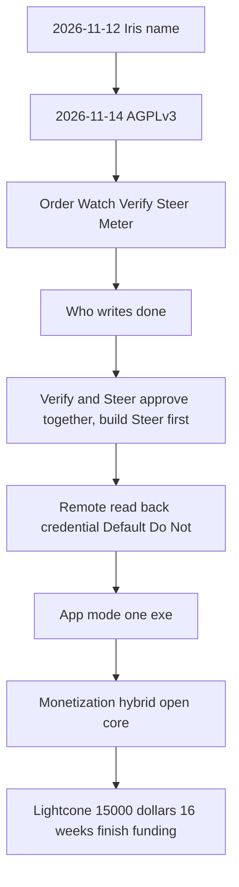

# Iris decisions

Author: Hogathos
Decided by: human
Written by: human
Filed by: CyberHog, agent, filing and formatting only
AI written: no
Human written: yes
Tags: human-written, human-decided

A public graph of the decisions that made Iris. One file per decision. One idea per file. Plain words. Short sentences.

This folder is the source of truth. Flywheel is a view of it, if used. The repo is the home.

## Map

## Decisions

1. [2026-11-12 Iris name](2026-11-12-iris-name.md)
2. [2026-11-14 AGPLv3](2026-11-14-agplv3.md)
3. [Order Watch Verify Steer Meter](order-watch-verify-steer-meter.md)
4. [Who writes done](who-writes-done.md)
5. [Verify and Steer approve together, build Steer first](verify-steer-approve-together-build-steer-first.md)
6. [Remote read back credential Default Do Not](remote-read-back-credential-default-do-not.md)
7. [App mode one exe](app-mode-one-exe.md)
8. [Monetization hybrid open core](monetization-hybrid-open-core.md)
9. [Lightcone 15000 dollars 16 weeks finish funding](lightcone-15000-16-weeks-finish-funding.md)

## Shape of a decision file

1. Problem, one sentence.
2. Intention, what had to be true.
3. Options, what was considered.
4. Choice, what was chosen.
5. Rejected, what was not chosen, and why.
6. Date, and status.
7. Links, to the spec, the commit, or the test, if there is one.

## What is not in here

No real name. No address. No phone. No email. No personal money detail. No full trademark report. No no contact rules. No drafts or DM texts. No person named as a collaborator or endorser unless they agreed in words.

Those stay private. This folder is public.
